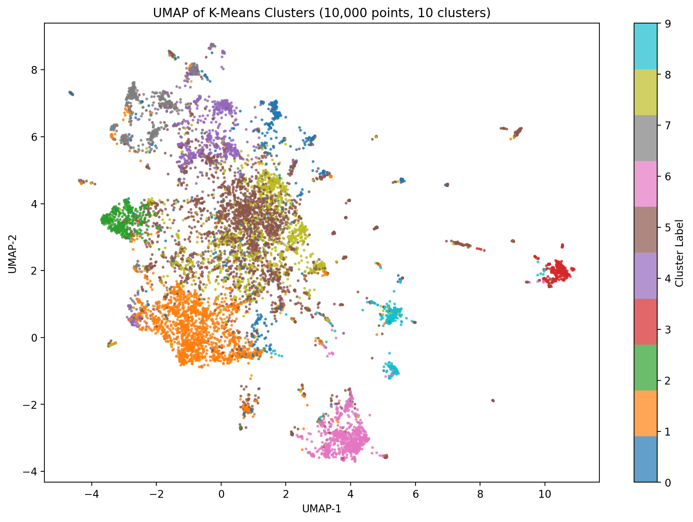
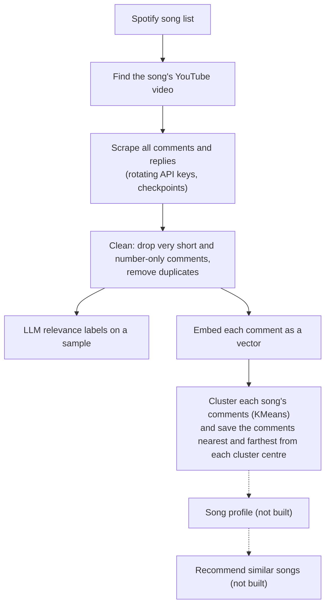

# Song recommendation engine

Recommend songs by what listeners say about them, not by genre or play counts. The plan: read every YouTube comment on a song, drop the noise, group what people say into themes, turn those themes into a profile of the song, and match songs by profile.

**How far it got:** we built collection, cleaning, and per-song clustering, and ran them at scale (4.19 million unique comments across 227 songs). Song profiles and recommendations were the next step and were never built. The comment work grew into a separate project, a [YouTube comment analyzer for creators](https://github.com/bigtopro/youtubeComments).



*10,000 comments on "Lose Yourself", one dot per comment, coloured by cluster. Comments that say similar things land close together.*

## Numbers from real runs

| What | Result | Evidence |
| --- | --- | --- |
| Songs listed | 511 Spotify tracks | [songList.txt](songList.txt) |
| Songs with comments loaded in Colab | 227 | [all_songs_load_dedup_embed.ipynb](colab/all_songs_load_dedup_embed.ipynb), saved output |
| Comments after the spam filter | 6.48 million, of which 2.29 million were duplicates, leaving 4.19 million unique | same notebook |
| One song in depth: "Lose Yourself" | 425,100 comments, 54.5% duplicates, 193,339 unique, clustered into 10 groups of 5,954 to 55,864 comments | [dedup summary](docs/lose_yourself_dedup_summary.json), [cluster summary](docs/lose_yourself_kmeans_k10_summary.json) |
| Other songs clustered | "7 Years" (k=10 and k=2), "Without Me" (k=3), "Mockingbird" (k=7, picked with the elbow method) | [per_song_embed_dedup_cluster.ipynb](colab/per_song_embed_dedup_cluster.ipynb), saved outputs |
| Comments labeled by an LLM for relevance | 14,350 | [labeled_comments_openrouter.json](labeled_comments_openrouter.json) |

One real labeled comment (`1` = relevant, worth keeping; `0` = generic or low-value):

```json
{
  "index": 20,
  "label": 1,
  "text": "My boyfriend sings this song are  prom and after 5more years we got married he loves me so much"
}
```

## How it works



To read what a cluster is about, the notebook saves the 100 to 1,000 comments closest to its centre and the ones farthest away. That turns 193,339 comments into a few pages you can actually read.

## What was hard

- **Scale.** The first attempt embedded all 4.19 million comments in one Colab run with a 768-dimension model on CPU. It managed 2.8 comments per second, finished 3%, and estimated 399 more hours. We switched to one song at a time on a GPU with a smaller 384-dimension model (`multilingual-e5-small`), with batch sizes that grow and shrink with GPU memory and retry after out-of-memory errors.
- **Duplicates.** Over half of a popular song's comments were exact repeats ("54.5% duplicate embeddings" on "Lose Yourself"), which would have let a few phrases dominate every cluster. Deduplication runs before clustering, in memory-safe chunks.
- **API quotas.** Each YouTube Data API key has a daily quota that a few popular songs can use up, so the scraper caches video matches, saves progress per song, and rotates keys as they run out.

## Where to look

| File | What it shows |
| --- | --- |
| [SpotifyToYouTubeCommentScraper.java](src/main/java/com/lucy/SpotifyToYouTubeCommentScraper.java) | Entry point: Spotify song → YouTube video → comments. |
| [YoutubeCommentScraper.java](src/main/java/com/lucy/YoutubeCommentScraper.java) | Paging through comments and replies, parallel fetching, key rotation. |
| [colab/all_songs_load_dedup_embed.ipynb](colab/all_songs_load_dedup_embed.ipynb) | Loading 227 songs in parallel, the spam filter, deduplication, the all-at-once embedding attempt. |
| [colab/per_song_embed_dedup_cluster.ipynb](colab/per_song_embed_dedup_cluster.ipynb) | Per-song embedding, deduplication, KMeans clustering, and cluster samples, with saved outputs. |
| [colab/translate_non_english_comments.ipynb](colab/translate_non_english_comments.ipynb) | A side experiment translating non-English comments; the main pipeline uses a multilingual embedding model instead. |
| [label_comments_openrouter.py](label_comments_openrouter.py) and [systemPromt.JSON](systemPromt.JSON) | Batched LLM relevance labeling and the criteria it uses. |

The other Markdown files at the top level are design notes (model choices, API limits, token counting) and can be skipped on a first read.

## Who built what

[sai-suneeth](https://github.com/sai-suneeth) wrote the original YouTube comment scraper. Venu (commits as `BarneyStinson4956`) added the Spotify integration, progress tracking and key management, the labeling scripts, and the Colab embedding and clustering notebooks.

## Running it

The Java scraper uses Maven and Java 8 and needs Spotify credentials and YouTube Data API keys (placeholders are in the code). The labeler needs an OpenRouter key and costs money per call. The notebooks expect comment files in Google Drive under `youtube_embeddings_project/` and run on Colab; the saved outputs show the original runs.
